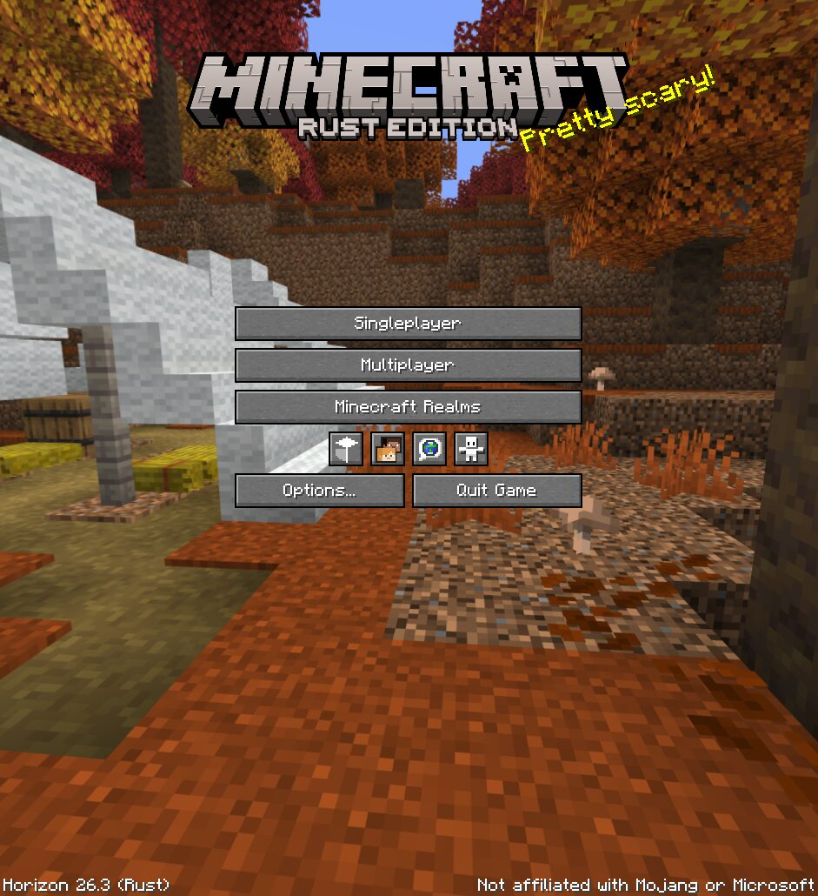

# Play Cubic and Earth

**Cubic** is a world type with no height limit. You can dig or climb for millions of blocks.

**Earth** is built on Cubic. Its land is the real one, made from public elevation data. Pick a place, like Mount Everest, and a scale.

You add it to the Horizon launcher as an imported build. You do not compile anything.



## What you need

- Your own copy of Minecraft: Java Edition. No Minecraft files come in the download.
- The Horizon launcher, version **0.2.70 or newer**. Older launchers refuse the build. Get the latest from the [Horizon releases](https://github.com/horizon-rust/horizon/releases) (look for "Horizon launcher"). To update, use Settings, or run `horizon-launcher update`.
- Horizon Nightly of **2026-11-22 (f1bb66f) or newer**.

## Steps

1. **Install the launcher.** Sign in there with your Minecraft account. The launcher handles sign-in.
2. **Play normal Horizon once.** On the Versions page, install the newest Nightly and play it one time. This prepares the game files from your own Minecraft.
3. **Download the zip for your system** from the [release page](https://github.com/ThatCakeIsAPie/horizon/releases):
   - Linux: `horizon-cubic-earth-<version>-linux-x64.zip`
   - Windows: `horizon-cubic-earth-<version>-windows-x64.zip`
   - Mac, Apple Silicon: `horizon-cubic-earth-<version>-macos-arm64.zip`
   - Mac, Intel: `horizon-cubic-earth-<version>-macos-x64.zip` (may be missing)

   Do not unzip it. The launcher reads the zip.
4. **Import it.** On the Versions page, press **Import a game build…** and pick the zip. The launcher says the build is unsigned. It runs with your rights, so accept only if you trust it. You are choosing to.
5. **Press Play.** The imported build is now selected for your instance.

Good to know:

- The import is a copy of the Nightly you have installed (game files too), with our program as the game. It is named "Imported · <date>".
- Imports use the version you selected. If none, the newest installed release or Nightly.
- Imported builds are listed apart and marked unsigned. Updates never replace them.
- The same thing from a terminal: `horizon-launcher import-build <zip> --trust-unsigned`. Add `--version <installed version>` to pick the base.
- If you unzip it yourself, pick the `horizon-client` program inside.
- If a much newer Nightly changes the game files, you will need a newer Cubic + Earth build.

## Your first world

1. Singleplayer, **Create New World**, then the **World** tab.
2. Press the **Cubic Chunks** button until it reads **Earth** (or **Custom Cubic** for a plain Cubic world).
3. For Earth, press the **Customize** beside it. Pick a place and a scale.
4. Create the world.

**Back up your worlds first.** Plain Horizon players cannot join a Cubic world. You cannot join theirs either.

## Earth asks before it downloads

When you make an Earth world, the game asks once: **Allow Earth downloads?**

It names two hosts:

- Map tiles: AWS Terrain Tiles (`s3.amazonaws.com`, `elevation-tiles-prod`).
- Land cover: `esa-worldcover.s3.eu-central-1.amazonaws.com`.

**Yes** downloads map tiles as you explore. **Cancel** downloads nothing.

## Data credits

The in-game **Data credits…** button shows these too.

Terrain comes from Terrain Tiles on AWS Open Data. The publisher requires this credit:

```
* ArcticDEM terrain data DEM(s) were created from DigitalGlobe, Inc., imagery and
  funded under National Science Foundation awards 1043681, 1559691, and 1542736;
* Australia terrain data © Commonwealth of Australia (Geoscience Australia) 2017;
* Austria terrain data © offene Daten Österreichs – Digitales Geländemodell (DGM)
  Österreich;
* Canada terrain data contains information licensed under the Open Government
  Licence – Canada;
* Europe terrain data produced using Copernicus data and information funded by the
  European Union - EU-DEM layers;
* Global ETOPO1 terrain data U.S. National Oceanic and Atmospheric Administration
* Mexico terrain data source: INEGI, Continental relief, 2016;
* New Zealand terrain data Copyright 2011 Crown copyright (c) Land Information New
  Zealand and the New Zealand Government (All rights reserved);
* Norway terrain data © Kartverket;
* United Kingdom terrain data © Environment Agency copyright and/or database right
  2015. All rights reserved;
* United States 3DEP (formerly NED) and global GMTED2010 and SRTM terrain data
  courtesy of the U.S. Geological Survey.
```

Land cover comes from ESA WorldCover 2021 v200 (CC BY 4.0, Zanaga et al. 2022, doi:10.5281/zenodo.7254221):

```
© ESA WorldCover project 2021 / Contains modified Copernicus Sentinel data (2021) processed by ESA WorldCover consortium
```

Earth was inspired by the Terrarium mod by gegy. It shares no code with it.

## Warnings about an unsigned program

The program is not signed. Your system may warn you.

**Windows.** SmartScreen may say "Windows protected your PC" when the game starts. Press **More info**, then **Run anyway**. Some antivirus programs may quarantine the file. Allow it.

**macOS.** Gatekeeper may say the game "cannot be opened because the developer cannot be verified", or that it is "damaged". Either:

- Open **System Settings → Privacy & Security** and press **Open Anyway**. Or
- Before importing, run this in Terminal: `xattr -dr com.apple.quarantine <the downloaded zip>`

## Go back to normal Horizon

On the Versions page, pick the normal version for your instance. The imported build stays listed until you remove it.

## Known limits

- Earth worlds have no trees or plants yet. The land is bare, with the right biomes.
- The far-terrain fade from older Earth builds is not carried over.
- Linux was tested start to finish.
- The Windows build is made by CI but has not been play-tested.
- macOS is untested.
- The program is unsigned.

## Licence and source

Horizon is LGPL-3.0-or-later. Older code stays under MIT. See `LICENSE` and `README.md`.

Source for this build: [ThatCakeIsAPie/horizon](https://github.com/ThatCakeIsAPie/horizon), branch `earth/up`. Each release names its tag.

Not affiliated with Mojang or Microsoft. No Minecraft files are in the zip. The launcher prepares them from your own copy.
